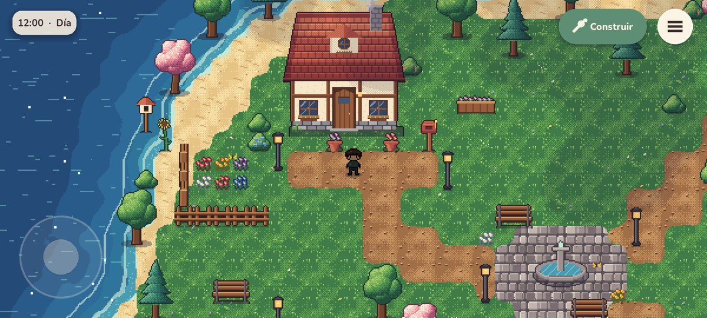

# Nuestro pequeño universo

Un videojuego 2D privado, en pixel art, para dos personas. Una pequeña isla que
se puede explorar, construir, decorar y llenar de recuerdos durante años.
Godot 4 · GDScript · Android.



## Estado

**Fase 2 (construcción y personalización): jugable en Godot, APK 0.2.0
exportado, sin probar todavía en teléfonos.** La isla se puede transformar:
catálogo de 36 objetos con variantes, colocar, mover, girar, guardar, quitar,
pintar el terreno y deshacer, todo guardado en el teléfono. Detalle honesto en
[documentation/ESTADO.md](documentation/ESTADO.md).

## Abrir y jugar

1. Instala [Godot 4.6](https://godotengine.org/download) (versión estándar).
2. Abre `project.godot` y pulsa ▶. En el ordenador, el ratón simula el dedo y
   también funcionan WASD/flechas (solo como ayuda de pruebas).

## Pruebas

```bash
godot --headless --import
godot --headless -s res://tests/run_tests.gd
```

## Android

Ver [documentation/ANDROID.md](documentation/ANDROID.md). Resumen:
`godot --headless --export-debug "Android" export/nuestro_universo.apk`.

## Regenerar el arte y el sonido

Todo el arte es original y se genera con Python (Pillow, NumPy, SciPy):

```bash
python3 tools/art/terrain.py assets/environment
python3 tools/art/props.py assets
python3 tools/art/props_garden.py assets
python3 tools/art/character.py assets/characters
python3 tools/art/audio.py assets/audio
python3 tools/art/island.py data/world/island_start.json
```

## Documentación

- [Plan del estudio](documentation/PLAN.md): decisiones, riesgos, fases, alcance v1.
- [Arquitectura](documentation/ARQUITECTURA.md)
- [Dirección artística](documentation/DIRECCION_ARTISTICA.md)
- [Universo compartido](documentation/UNIVERSO_COMPARTIDO.md) (diseño de la Fase 4)
- [Android](documentation/ANDROID.md)
- [Estado y tareas](documentation/ESTADO.md)

## Licencias

Código y arte: propios del proyecto. Tipografía Nunito bajo SIL Open Font
License (`assets/fonts/OFL-Nunito.txt`).
