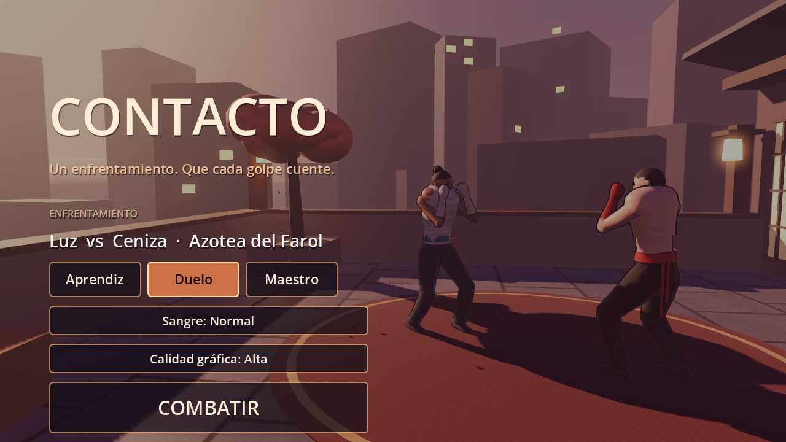
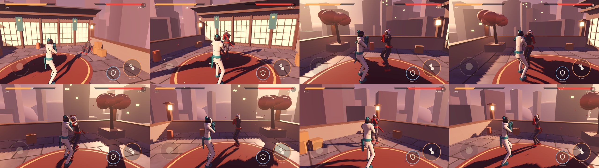
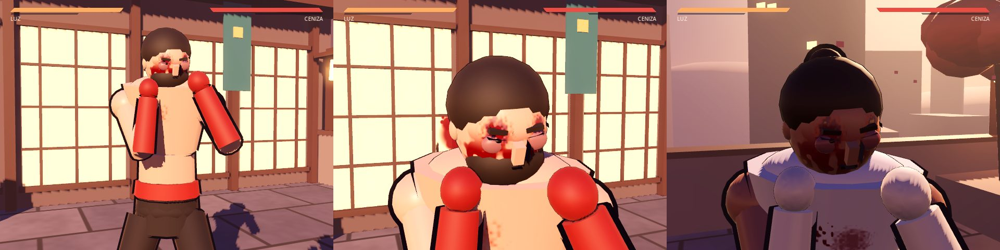
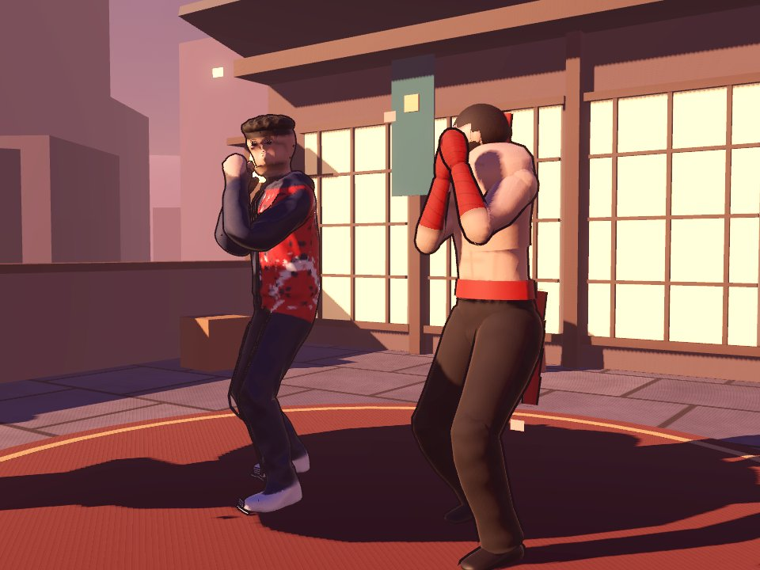

# CONTACTO — prototipo de combate 3D para Android

Proyecto independiente (no tiene relación con el juego de la isla de este
repositorio). Un enfrentamiento, dos personajes, un escenario: todo el esfuerzo
está puesto en que cada golpe se sienta bien.





## Estado



**Versión 0.6.0: Nico, modelo 3D importado, es el jugador** (el GLB sin esqueleto se
prepara con `tools/model_prep.py` y `tools/build_model.gd`; ver [docs/ESTADO.md](docs/ESTADO.md)).
Antes, en la 0.5.0: **audio completo con ElevenLabs** (golpes, voces de los luchadores,
locutor, música de menú y de combate, ambiente; ver [docs/AUDIO.md](docs/AUDIO.md)).
Antes, en la 0.4.0: Cuerpos esculpidos (anatomía, cara, pelo, barba, ropa que
se rompe), física parcial en las reacciones, vibración con matices, plano de
remate y repetición del KO, y ajustes de combate en vivo. Antes, en la 0.3.0: Combate rediseñado para que golpear se sienta bien: botones
separados de puño, patada, defensa y esquiva; series largas fluidas; reacciones
sin destello blanco; colisiones limpias; sangre mucho más presente.
Antes, en la 0.2.0: Luchadores callejeros con cara, piel y
ropa; daño visible por zona (moretones donde cae el golpe, nariz y labio que
sangran, ceja abierta, ojo hinchado, sangre en la camiseta, el suelo y la pared);
barra de equilibrio, golpes que dependen de la distancia, empujón y
contraataque tras esquiva. **APK exportado** (ver `../apk/`). Las pruebas automáticas pasan (~1800
comprobaciones) y el juego se ha revisado con capturas reales del renderizador
GL Compatibility. **Aún no se ha probado en un teléfono** (ver
[docs/ESTADO.md](docs/ESTADO.md)).

## Jugar en el ordenador

1. Godot 4.6 estándar → abrir `combate/project.godot` → ▶.
2. El ratón simula el dedo. Teclado de ayuda: WASD mover · J golpe · L patada
   fuerte · K defensa (con dirección = esquiva) · I remate · P pausa.

## Controles táctiles (horizontal)

| Control | Acción |
|---|---|
| Joystick flotante (mitad izquierda) | Moverse; el personaje siempre encara al rival. |
| **GOLPE** | Machacar encadena puños en bucle: jab → directo → gancho → gancho al cuerpo → directo… Pegado al rival empieza con gancho; atrás + GOLPE es un empujón; contra un rival tambaleándose sale un uppercut. |
| **PATADA** | Sola: patada baja al muslo (cerca, rodillazo). En mitad de una serie la remata: patada circular, y a partir del 4.º golpe patada giratoria que derriba. Hacia el rival + PATADA: patada frontal (mantener = cargar). |
| **DEFENSA** | Mantener: guardia (llena la barra de equilibrio; llena = guardia rota). Tocar justo antes del impacto: parada. |
| **ESQUIVA** | Con dirección: esquiva hacia allí. Sin dirección: quiebro lateral. Si un golpe te roza, GOLPE se vuelve **CONTRA** (uppercut) y PATADA, patada giratoria. |
| **REMATE** | Solo aparece si el rival está aturdido: agarre + rodillazo. |

Las series largas tienen límite natural: cada golpe acorta el aturdimiento del
rival y al noveno sale despedido. En el menú: **Sangre: Normal / Reducida /
Apagada**. Teclado: WASD · J golpe · K patada · L defensa · Espacio esquiva ·
I remate · P pausa.

## Pruebas y capturas

```bash
godot --headless --import
godot --headless -s res://tests/run_tests.gd
xvfb-run -a godot --rendering-driver opengl3 -s res://tests/capture.gd -- /tmp fight 1
xvfb-run -a godot --rendering-driver opengl3 -s res://tests/capture.gd -- /tmp pose roundhouse 0.225 70
```

## Android

Con Android SDK (build-tools 35 y platform-tools), JDK 17+ y las plantillas de
exportación de Godot 4.6.2 configuradas en el editor:

```bash
godot --headless --export-debug "Android" export/contacto.apk
adb install -r export/contacto.apk
```

El preset ya pide el permiso de vibración, pantalla completa inmersiva y
arm64-v8a + armeabi-v7a.

## Sonido

Efectos, voces y música generados con ElevenLabs (`assets/audio/eleven`, procesados con
`tools/process_audio.py`); la capa grave bajo los golpes está sintetizada
(`python3 tools/gen_audio.py assets/audio`). Detalles y licencia en
[docs/AUDIO.md](docs/AUDIO.md).

## Documentación

- [Diseño y decisiones](docs/DISENO.md): investigación, motor, dirección
  visual, sistema de animación, cámara, IA, controles y optimización.
- [Estado honesto y siguientes pasos](docs/ESTADO.md)

## Licencias

Todo el código, las formas, los shaders y los sonidos son propios del proyecto.
El modelo de Nico (`assets_src/nico.glb`) lo aportó el autor del proyecto. Tipografía: la fuente por defecto de Godot.
