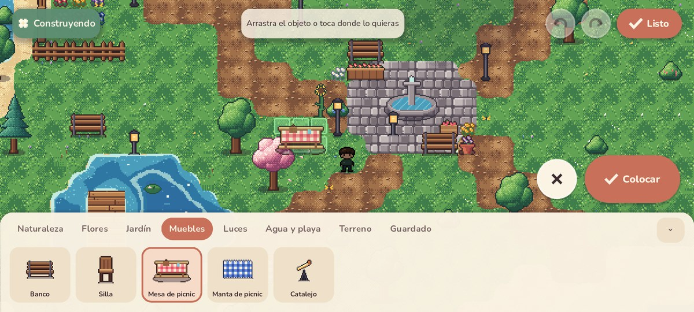
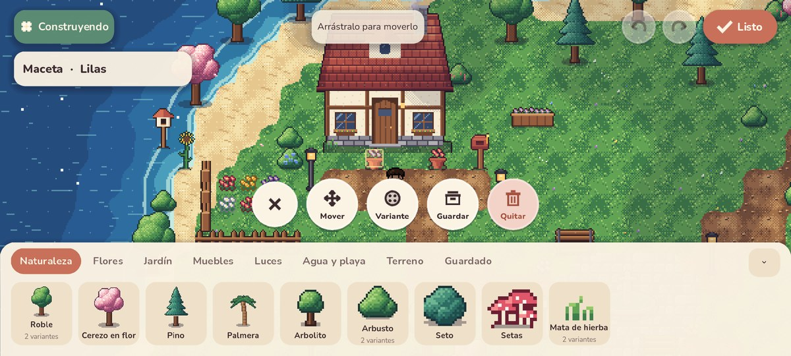
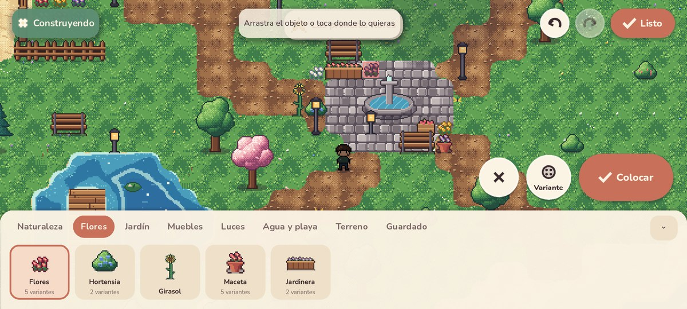
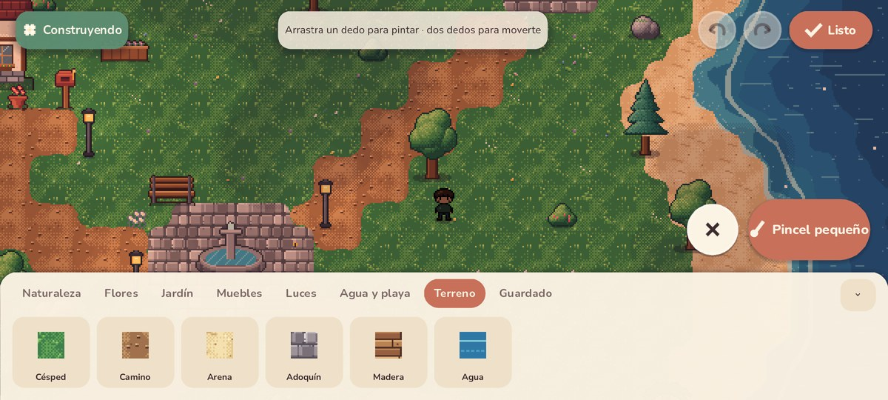
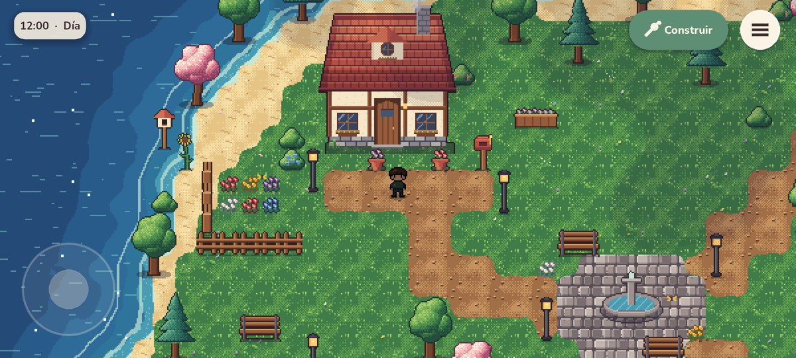
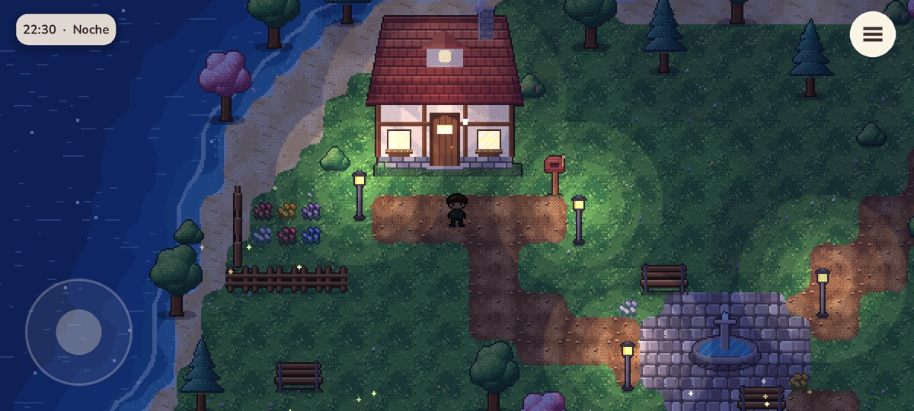

# Estado del proyecto

Última actualización: 18 de noviembre de 2026 · Versión 0.2.0 · **Fase 2 (construcción)**

## Niveles de verificación

- **I** implementado · **R** revisado · **G** probado en Godot (pruebas
  automáticas o capturas reales) · **A** probado en un Android · **2** probado en
  los dos teléfonos.

**Nada está probado en un teléfono todavía (niveles A y 2 pendientes).**
Las pruebas automáticas actuales: 733 comprobaciones, 0 fallos.

## Fase 2: construcción y personalización

| Sistema | Nivel | Notas |
|---|---|---|
| Guardado local del mundo (`user://world.json`) | G | Terreno, objetos, variantes, faroles, inventario e hitos. Atómico con `.bak`. Se guarda 1,2 s después de cada cambio, al salir del modo construcción y al pausar la app. |
| Catálogo con 7 pestañas y 36 objetos (20 nuevos) | G | Naturaleza, Flores, Jardín, Muebles, Luces, Agua y playa + Terreno y Guardado. |
| Variantes (colores y orientación) | G | Valla horizontal/lateral, flores ×5, macetas ×5, robles ×2, arbustos ×2, hortensias ×2, jardineras ×2, hierba ×2. |
| Validación de posición | G | Fuera de la isla, superficie incorrecta («Va sobre césped o tierra»), celda ocupada, personaje encima. El motivo se muestra con calma, sin bloquear. |
| Colocar con vista previa | G | El objeto «fantasma» flota sobre su huella: verde si cabe, coral si no. Modo sello: tras colocar, sigue listo para poner otro igual. |
| Seleccionar, mover, girar/variante, guardar, quitar | G | Tocar un objeto lo selecciona (con brillo y huella). Arrastrarlo lo mueve directamente; también hay botón «Mover». |
| Las matas de hierba se apartan solas | G | Al colocar algo encima o pintar otro suelo; se restauran al deshacer. |
| Inventario («Guardado») | G | Los objetos guardados conservan su identidad e historia; se agrupan con contador. Estado vacío que explica qué hacer. |
| Pintar terreno con el dedo | G | 6 materiales (incluida agua: se pueden excavar estanques), pincel pequeño/grande, un trazo = un paso de deshacer. No pinta bajo objetos ni bajo el personaje. |
| Deshacer / rehacer (150 pasos) | G | Sin diálogos de confirmación: todo es reversible. Formato de operaciones listo para la sincronización de la Fase 4. |
| Objetos con historia | G | Cada objeto nuevo guarda quién lo colocó y cuándo; se muestra al seleccionarlo («Lo puso Personaje A · hace 3 días»). |
| Hitos de la isla | G | «El primer árbol plantado por vosotros», «Las primeras flores», etc., con un pequeño destello. Base de la línea de tiempo. |
| Cámara libre en construcción | I/R | Un dedo mueve la vista; dos dedos mueven y hacen zoom. **Sin probar con dedos reales.** |
| Sonidos de construcción | I | Pop al colocar, recoger, pincel, deshacer, «boop» suave si no cabe, destello de hito. Provisionales (sintetizados). |
| Decoración interior | — | Pendiente: llega con los interiores de la casa (Fase 3). El catálogo y el sistema ya sirven para ello. |

## Fase 1 (resumen)

Escenario pixel-perfect, terreno dual-grid, agua por shader, isla inicial,
personaje por capas (prototipo), joystick y botones multitáctiles, zoom,
interacciones (sentarse, contemplar, faroles, textos), día/noche con la hora
real, ambientación, audio, ajustes, exportación APK: todo en nivel **G**.

## Refinado visual de esta versión

- Césped y caminos con menos ruido: superficies más tranquilas y acogedoras.
- Luz del día ligeramente cálida.
- Buhardilla de la casa con marco de madera, ventana con cruz y jardinera.
- Rincones nuevos en la isla: macetas junto a la puerta, casita de pájaros,
  girasol, hortensia, jardinera, picnic junto al lago con farolillo.
- Iconos de interfaz en pixel art propio (sin depender de símbolos de la fuente).

## Provisional / pendiente

- **Personajes: prototipo.** Se rediseñarán más bonitos y parecidos a
  vosotros (Fase 3, con editor de apariencia).
- Sonido sintetizado provisional.
- Desplazar el cajón del catálogo con el dedo usa el comportamiento estándar de
  Godot en pantallas táctiles: hay que confirmarlo en el teléfono.
- La valla lateral sigue siendo algo delgada.

## Errores conocidos

- Ninguno detectado por las pruebas.

## Próximas tareas

1. **Probar el APK 0.2.0 en el teléfono** (ver [ANDROID.md](ANDROID.md)), sobre
   todo: arrastrar objetos, pintar, desplazar el cajón, zoom.
2. Fase 3: dos personajes bonitos y personalizables, interiores de la casa
   (entrar por la puerta), muebles de interior, cuadros con fotos reales.
3. Decidir la clave de firma definitiva antes de guardar recuerdos.

## Capturas reales (Godot 4.6.2, 2400×1080)

| | |
|---|---|
|  |  |
|  |  |
|  |  |
