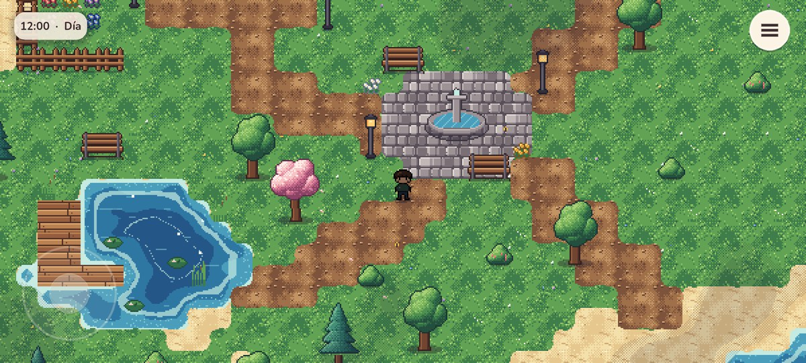
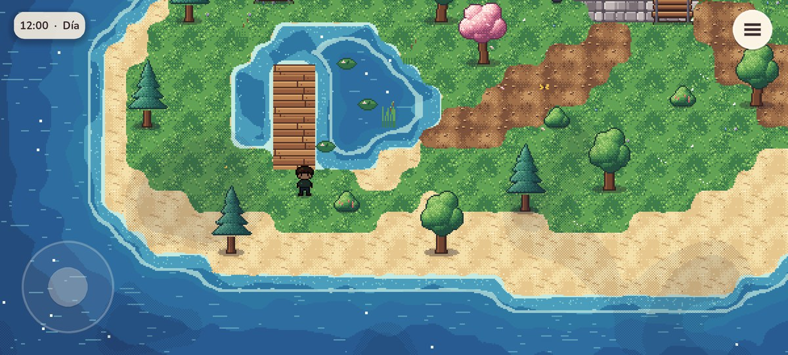
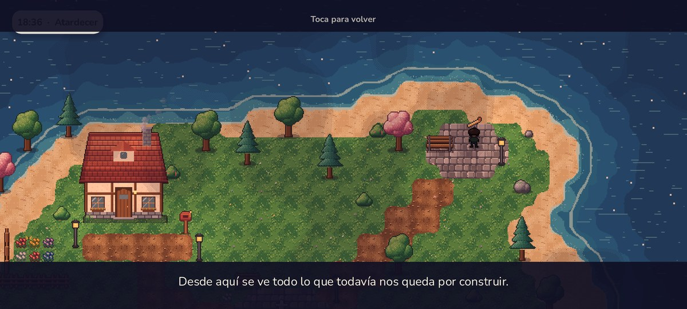
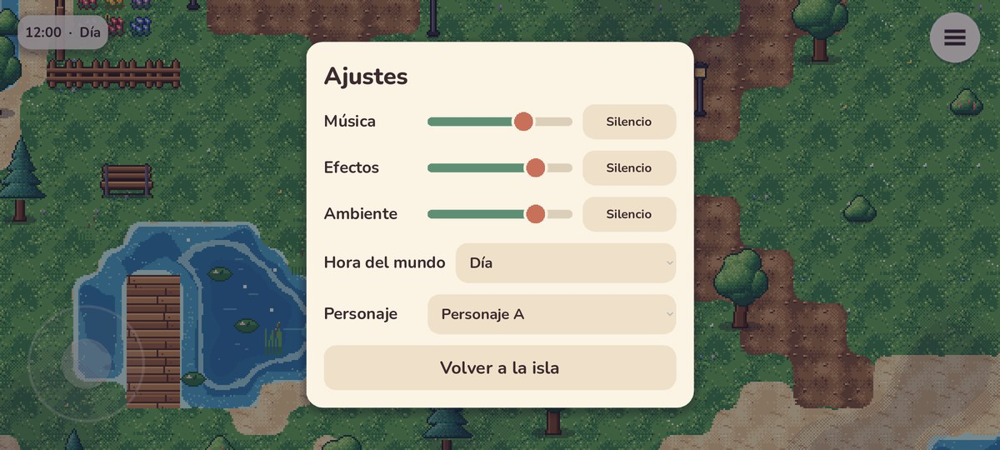

# Estado del proyecto

Última actualización: 17 de noviembre de 2026 · Versión 0.1.0 · **Fase 1**

## Niveles de verificación

Para no confundir lo hecho con lo probado (punto 28-H):

- **I** implementado · **R** revisado · **G** probado en Godot (pruebas
  automáticas o capturas reales) · **A** probado en un Android · **2** probado en
  los dos teléfonos.

## Fase 1: fundamentos y prototipo artístico

| Sistema | Nivel | Notas |
|---|---|---|
| Proyecto Godot 4.6 (GL Compatibility, horizontal) | G | Arranca sin errores de script. |
| Escenario pixel-perfect con escala entera | G | Capturas a 2400×1080: píxeles nítidos ×4. |
| Terreno dual-grid (arena, césped, tierra, adoquín, madera) | G | Bordes orgánicos, transiciones limpias. |
| Agua animada (profundidad, espuma, oleaje, destellos) | G | Mar y lago. |
| Colisiones de costa y objetos | G | Comprobado por pruebas; no jugado a mano. |
| Isla inicial: casa, jardín, lago con muelle, plaza, mirador, playa | G | 56×40 celdas, 139 objetos colocados. |
| Catálogo de objetos basado en datos (28 objetos) | G | JSON + PNG, validado por pruebas. |
| Personaje por capas, 4 direcciones, caminar/reposo/sentado | G | Dos apariencias predefinidas (A y B). |
| Joystick flotante, botón contextual multitáctil, zoom con dos dedos | I/R | Hecho para pantallas táctiles; **sin probar con dedos reales**. |
| Interacciones: sentarse, contemplar (mirador), farol, mirar objetos | G | Pruebas automáticas + captura de la cinemática. |
| Ciclo de día y noche con la hora real | G | Capturas de día, atardecer y noche. |
| Luces nocturnas, ventanas, luciérnagas, pétalos, humo, mariposas, nubes | G | |
| Interfaz: reloj, ajustes (volúmenes, silencio, hora, personaje), portada | G | |
| Audio (olas, grillos, pájaros, pasos por suelo, música, interfaz) | I | **Provisional**: sintetizado; sin escuchar en un altavoz real. |
| Guardado local atómico con copia de seguridad | G | Incluye prueba de recuperación de archivo dañado. |
| Posición del personaje recordada al cerrar | I | Se guarda al pausar/cerrar la app. |
| Área segura (muescas), botón atrás de Android | I | Solo se activa en móvil; sin probar. |
| Exportación APK Android | G | **Exportado y firmado de verdad**; no instalado en ningún teléfono. |

**Nada está probado en un teléfono todavía (niveles A y 2 pendientes).**

## Provisional / pendiente de mejorar

- Sonido sintetizado: sustituir por grabaciones o composición con licencia.
- La valla lateral (`fence_v`) es demasiado delgada; la buhardilla de la casa
  puede mejorarse.
- El lago es pequeño y el muelle lo divide; revisar composición.
- Variedad de animaciones: faltan interactuar y animaciones especiales.
- La puerta de la casa todavía no lleva a ningún interior (Fase 3).
- El buzón todavía no recibe cartas (Fase 5); su texto lo dice con honestidad.

## Errores conocidos

- Ninguno detectado por las pruebas. Al cerrar Godot en modo prueba aparecen
  avisos de «recursos en uso al salir» (inofensivos, por los cachés estáticos).

## Próximas tareas (Fase 2: construcción y personalización)

1. Modelo de datos del mundo y guardado local del estado de la isla
   (objetos colocados, terreno pintado, estado de faroles) con `LocalStore`.
2. Modo construcción: botón en el HUD, cuadrícula visible, vista previa con
   indicador válido/no válido según `surfaces`, colisiones y límites.
3. Catálogo e inventario en panel inferior deslizable (no tapa el mundo).
4. Seleccionar, mover (arrastrar), girar (variantes), borrar, recuperar al
   inventario.
5. Herramienta de terreno: elegir material y pintar con el dedo (`TerrainGrid.paint`).
6. Deshacer / rehacer (pila de operaciones: la misma que luego se sincroniza).
7. Más objetos: banco de picnic, macetas, farolillos, arriates, caminos de losas.
8. Pruebas: colocar, mover, borrar, pintar, cerrar, abrir y comprobar.

## Capturas reales (Godot 4.6.2, 2400×1080)

| | |
|---|---|
|  |  |
|  |  |
|  |  |
